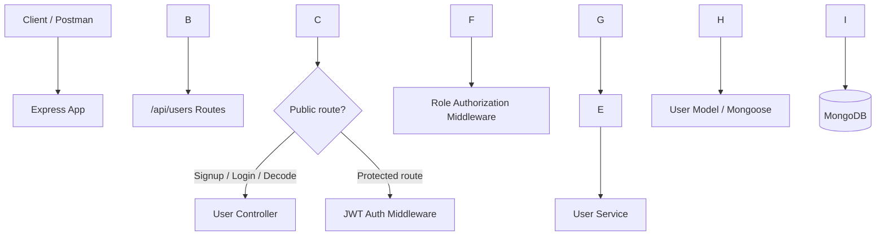
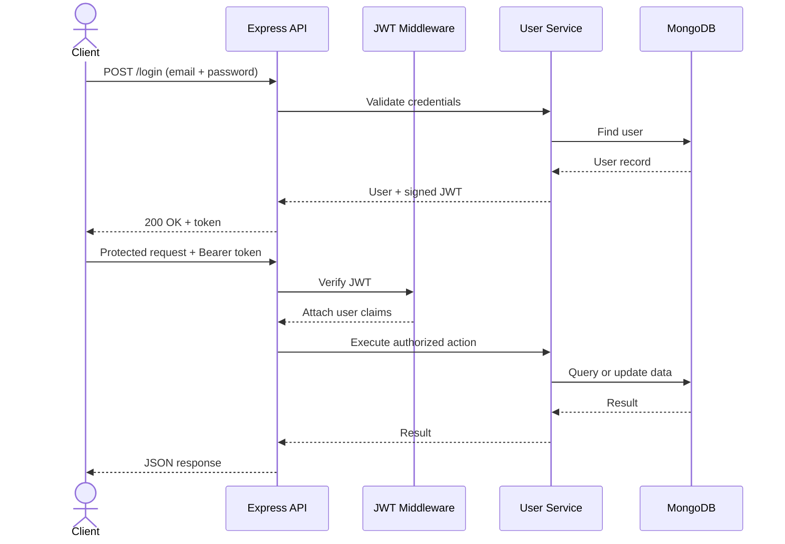

<div align="center">
🎓 Student & Teacher Management API
A role-based REST API built with Node.js, Express, MongoDB and JWT


<br/>
Features · Getting Started · API Reference · Examples · Security
<br/>

</div>
---
✨ Overview
A backend REST API for managing Students and Teachers with account registration, login, JSON Web Token (JWT) authentication, and role-based access control.
The API separates responsibilities into routes, controllers, services, middleware, models, and database configuration to keep the codebase organized and easier to maintain.
🚀 Features
🔐 Signup & Login — create accounts and authenticate with email and password.
🔑 JWT authentication — signed access tokens with a 1-day expiry.
🔒 Password hashing — passwords are hashed using `bcryptjs`.
👥 Role-based access — supports `Student` and `Teacher` roles.
🎓 Student endpoints — list students, fetch a student by ID, and allow teachers to update a student.
🧑‍🏫 Teacher endpoints — list and fetch teachers; restricted to teacher accounts.
🪪 Token decoding/verification — validate a token and retrieve its associated active user.
🗄️ MongoDB persistence — data is stored through Mongoose.
🧩 Environment configuration — secrets and connection settings are loaded from `.env`.
🧰 Tech Stack
Technology	Purpose
Node.js	JavaScript runtime
Express.js	HTTP server and routing
MongoDB	Database
Mongoose	MongoDB object modeling
JSON Web Token (`jsonwebtoken`)	Token creation and verification
`bcryptjs`	Password hashing and comparison
`dotenv`	Load local environment variables
Nodemon	Restart the server during development
🏗️ Architecture

📁 Project Structure
```text
doodleblue\_task/
├── app.js                         # Express app and server startup
├── config/
│   └── db.js                      # MongoDB connection
├── controllers/
│   └── user.controllers.js        # Request/response handling
├── middlewares/
│   ├── auth.middleware.js         # JWT verification
│   └── role.middleware.js         # Role authorization
├── models/
│   └── user.model.js              # User schema
├── routes/
│   └── user.routes.js             # API endpoints
├── services/
│   └── user.services.js           # Business logic
├── .env                           # Local secrets (not for Git)
├── .gitignore                     # Ignore local-only files
├── package.json
├── package-lock.json
└── README.md
```
⚙️ Getting Started
Prerequisites
Node.js (LTS recommended)
npm (included with Node.js)
A running MongoDB instance or a MongoDB Atlas cluster
Git (optional)
1. Clone the repository
```bash
git clone <YOUR\_GITHUB\_REPOSITORY\_URL>
cd doodleblue\_task
```
Replace the placeholder with your actual GitHub repository URL.
2. Install dependencies
```bash
npm install
```
`node\_modules/` is generated by npm from `package.json` and `package-lock.json`; it should not be committed to Git.
3. Configure environment variables
Create a local file named `.env` in the project root:
```env
PORT=5000
MONGO\_URI=mongodb://127.0.0.1:27017/student\_teacher\_db
JWT\_SECRET=replace\_with\_a\_long\_random\_secret
```
Variable	Description
`PORT`	Port used by the API server
`MONGO\_URI`	MongoDB connection string
`JWT\_SECRET`	Secret used to sign and verify JWTs
Important: These are example values. Use your own database URI and a strong, private JWT secret. Never paste real credentials into the README or commit them to Git. If using MongoDB Atlas, use the connection string from your own Atlas cluster.
4. Start the server
```bash
npm start
```
The current `package.json` runs `nodemon app.js` for this script. When the database connection succeeds, the terminal should show output similar to:
```text
MongoDB Connected Successfully
Server is running on port: 5000
```
If MongoDB cannot connect, check `MONGO\_URI`, network access, and your database credentials.
5. Base URL
```text
http://localhost:5000/api/users
```
Use Postman, Insomnia, or `curl` to test the endpoints below.
📚 API Reference
All endpoints are prefixed with `/api/users`.
Authentication & account
Method	Endpoint	Access	Purpose
`POST`	`/signup`	Public	Register a Student or Teacher
`POST`	`/login`	Public	Verify credentials and receive a JWT
`POST`	`/decode`	Public, token required in request	Verify token and return decoded claims and active user
`PUT`	`/profile`	Authenticated	Update the logged-in user's profile
Students
Method	Endpoint	Access	Purpose
`GET`	`/students`	Student or Teacher	List active students
`GET`	`/students/:id`	Student or Teacher	Fetch an active student by MongoDB ID
`PUT`	`/students/:id`	Teacher	Update a student by ID
Teachers
Method	Endpoint	Access	Purpose
`GET`	`/teachers`	Teacher	List active teachers
`GET`	`/teachers/:id`	Teacher	Fetch an active teacher by MongoDB ID
Authorization behavior
Signup, login, and decode are registered before the authentication middleware.
The remaining routes require `Authorization: Bearer <token>`.
Student listing and lookup allow both `Student` and `Teacher`.
Teacher listing and lookup, and updating a student, require the `Teacher` role.
A missing/invalid token returns `401`; a role restriction returns `403`.
A record that is not found returns `404` on the individual student/teacher lookup endpoints.
🧪 Request & Response Examples
Examples below use the local base URL `http://localhost:5000/api/users`. IDs and tokens are illustrative; use values returned by your own API.
1. Sign up
Request
```http
POST /api/users/signup
Content-Type: application/json
```
```json
{
  "name": "Arun Kumar",
  "email": "arun@example.com",
  "password": "ExamplePassword123!",
  "role": "Student",
  "department": "Computer Science"
}
```
Example success response (`201 Created`)
```json
{
  "message": "Signup success",
  "user": {
    "\_id": "66f000000000000000000001",
    "name": "Arun Kumar",
    "email": "arun@example.com",
    "role": "Student",
    "department": "Computer Science",
    "isActive": true
  }
}
```
The response shape above is illustrative; MongoDB generates the real `\_id` and timestamps.
2. Log in
Request
```http
POST /api/users/login
Content-Type: application/json
```
```json
{
  "email": "arun@example.com",
  "password": "ExamplePassword123!"
}
```
Example success response (`200 OK`)
```json
{
  "message": "Login success",
  "user": {
    "\_id": "66f000000000000000000001",
    "name": "Arun Kumar",
    "email": "arun@example.com",
    "role": "Student",
    "department": "Computer Science",
    "isActive": true
  },
  "token": "<JWT\_TOKEN>"
}
```
Copy the returned token and send it with protected requests:
```http
Authorization: Bearer <JWT\_TOKEN>
```
3. Get all students
Request
```bash
curl http://localhost:5000/api/users/students \\
  -H "Authorization: Bearer <JWT\_TOKEN>"
```
Example response (`200 OK`)
```json
\[
  {
    "\_id": "66f000000000000000000001",
    "name": "Arun Kumar",
    "email": "arun@example.com",
    "role": "Student",
    "department": "Computer Science",
    "isActive": true
  }
]
```
4. Update your profile
Request
```http
PUT /api/users/profile
Authorization: Bearer <JWT\_TOKEN>
Content-Type: application/json
```
```json
{
  "name": "Arun K",
  "department": "Information Technology"
}
```
Example response
```json
{
  "message": "Profile updated successfully",
  "user": {
    "\_id": "66f000000000000000000001",
    "name": "Arun K",
    "email": "arun@example.com",
    "role": "Student",
    "department": "Information Technology"
  }
}
```
5. Common error response shapes
```json
{ "message": "Access Denied: No token provided" }
```
```json
{ "message": "Invalid or expired token" }
```
```json
{ "message": "Token is required" }
```
Exact messages depend on the endpoint and failure condition.
🔐 Security Notes
Why `.env` is ignored
This project's `.gitignore` contains:
```gitignore
.env
node\_modules
```
`.env` stores local configuration and sensitive values such as `MONGO\_URI` and `JWT\_SECRET`. It should stay on your machine and must not be uploaded to GitHub.
`node\_modules/` contains installed third-party packages. Anyone cloning the repository can recreate it with `npm install`; committing it makes the repository unnecessarily large.
`package.json` and `package-lock.json` should be committed so dependencies and their resolved versions can be installed reproducibly.
> ⚠️ \*\*Git note:\*\* `.gitignore` only prevents \*untracked\* matching files from being added. It does not remove files that Git is already tracking. Check the repository's existing Git history before publishing.
Recommended before publishing
Keep `.env` private and add a safe `.env.example` containing placeholder values only.
Never expose a real database password or JWT secret in screenshots, logs, commits, or documentation.
Validate and whitelist fields accepted by profile/student update endpoints before using this API in production.
Consider rate limiting, request validation, and production-grade error handling before deploying publicly.
🗺️ Typical Request Flow

🤝 Contributing
Fork the repository.
Create a branch: `git checkout -b feature/your-feature`.
Make and test your changes.
Commit your changes: `git commit -m "Add your feature"`.
Push the branch and open a Pull Request.
📄 License
No project-specific license is declared yet. Add a `LICENSE` file before presenting this repository as open source.
---
<div align="center">
Built with ❤️ using Node.js, Express and MongoDB
<sub>If this project helped you, consider giving the repository a ⭐</sub>
</div>
